# Litgrid

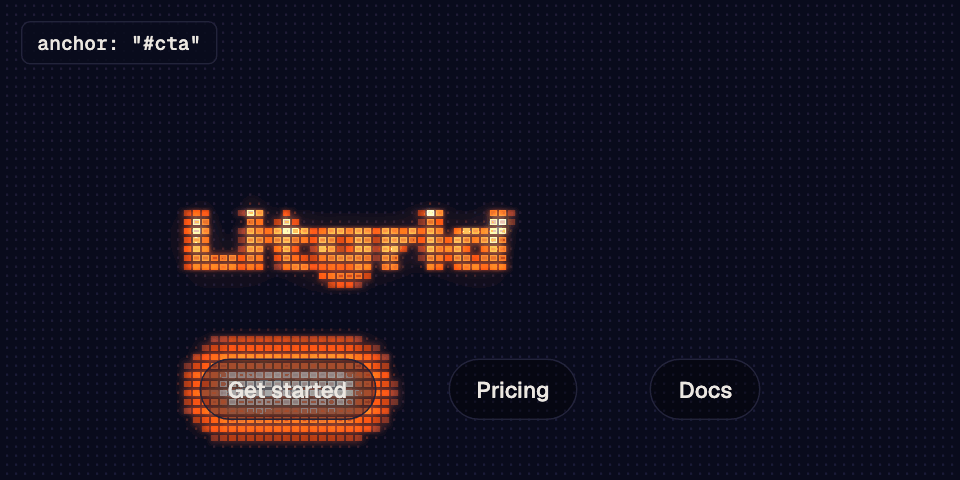

A grid of cells that lights up with the light in the scene: dark becomes a dim dot, mid
becomes a solid cell, and bright becomes a hollow, lit cell, with glow and scanlines on
top. It's the CRT/LED panel look, rebuilt in the browser with the 2D canvas, as a
framework-agnostic package with no dependencies.

Tune it in the editor at https://ampulla-tech.github.io/litgrid/, press "Copy settings",
and pass that JSON to the package.

## Install

```sh
npm i @ampulla/litgrid
```

Or straight from a CDN: `https://unpkg.com/@ampulla/litgrid@0.2` is the script-tag build,
which exposes `window.Litgrid`, and
`https://cdn.jsdelivr.net/npm/@ampulla/litgrid@0.2/dist/litgrid.js` is the ES module.

Each canvas gets its own instance, `createLitgrid(canvas, options)`, released with
`destroy()`. Importing the package never touches `window`, `document` or `matchMedia`, so
it is safe to import on a server.

## Usage

### Plain HTML, script tag

<!-- example: examples/html/script.html -->
```html
<canvas id="lit" style="width: 100%; aspect-ratio: 16 / 9"></canvas>
<script src="https://unpkg.com/@ampulla/litgrid@0.2"></script>
<script>
  const lg = Litgrid.createLitgrid(document.getElementById("lit"), {
    settings: { text: "Hello", followMouse: true },
    pointer: window,
    magnets: "a, button",
  });
</script>
```

### Plain HTML, module

<!-- example: examples/html/module.html -->
```html
<canvas id="lit" style="width: 100%; aspect-ratio: 16 / 9"></canvas>
<script type="module">
  import { createLitgrid } from "https://cdn.jsdelivr.net/npm/@ampulla/litgrid@0.2/dist/litgrid.js";

  const lg = createLitgrid(document.getElementById("lit"), {
    settings: { text: "Hello", followMouse: true },
  });
</script>
```

### React

Create the instance in an effect and destroy it in the cleanup; a second effect passes new
settings to `update()` (keep the settings object stable, with `useMemo` or state, so it
only runs when they change):

<!-- example: examples/react/Litgrid.tsx -->
```tsx
import { useEffect, useRef } from "react";
import { createLitgrid, type Litgrid as Instance, type Settings } from "@ampulla/litgrid";

export function Litgrid({ settings }: { settings?: Partial<Settings> }) {
  const canvas = useRef<HTMLCanvasElement>(null);
  const lg = useRef<Instance>(null);
  useEffect(() => {
    lg.current = createLitgrid(canvas.current!, { settings });
    return () => lg.current?.destroy();
  }, []);
  useEffect(() => { if (settings) lg.current?.update(settings); }, [settings]);
  return <canvas ref={canvas} style={{ width: "100%", aspectRatio: "16 / 9" }} />;
}
```

### Vue

Create it in `onMounted`, destroy it in `onBeforeUnmount`, and `watch` the settings:

<!-- example: examples/vue/Litgrid.vue -->
```vue
<script setup lang="ts">
import { onBeforeUnmount, onMounted, ref, watch } from "vue";
import { createLitgrid, type Litgrid, type Settings } from "@ampulla/litgrid";

const props = defineProps<{ settings?: Partial<Settings> }>();
const canvas = ref<HTMLCanvasElement>();
let lg: Litgrid | undefined;
onMounted(() => { lg = createLitgrid(canvas.value!, { settings: props.settings }); });
onBeforeUnmount(() => lg?.destroy());
watch(() => props.settings, (s) => { if (s) lg?.update(s); }, { deep: true });
</script>

<template>
  <canvas ref="canvas" style="width: 100%; aspect-ratio: 16 / 9" />
</template>
```

### Server rendering (Next, Nuxt, Astro, SvelteKit)

Import the package anywhere, and create the instance only in the browser: in an effect
(React, Next), in `onMounted` (Vue, Nuxt), or in a client script (Astro, SvelteKit's
`onMount`). In Next's app router the component is a client component:

<!-- example: examples/ssr/Litgrid.tsx -->
```tsx
"use client";
import { useEffect, useRef } from "react";
import { createLitgrid, type Litgrid as Instance, type Settings } from "@ampulla/litgrid";

// rendered on the server as a plain <canvas>; the instance only exists in the browser
export function Litgrid({ settings }: { settings?: Partial<Settings> }) {
  const canvas = useRef<HTMLCanvasElement>(null);
  const lg = useRef<Instance>(null);
  useEffect(() => {
    lg.current = createLitgrid(canvas.current!, { settings });
    return () => lg.current?.destroy();
  }, []);
  useEffect(() => { if (settings) lg.current?.update(settings); }, [settings]);
  return <canvas ref={canvas} style={{ width: "100%", aspectRatio: "16 / 9" }} />;
}
```

These examples are built and run in CI from the files under `examples/`, and a check fails
when this README and those files differ.

## Options

`createLitgrid(canvas, options)` takes:

| Option | What it is |
|---|---|
| `settings` | The JSON from the editor's "Copy settings", whole or in part, over the defaults. Nothing is read from or saved to the browser, so the colors and everything else come only from here. |
| `media` | What the grid lights up from: an image or video URL (another origin needs CORS), or an ``, `<video>` or `<canvas>`. A `<canvas>` is read again on every frame, and its size too. |
| `size` | `[width, height]` of the drawing in pixels. By default, the canvas' displayed size times the pixel ratio. |
| `pointer` | Where the light listens to the pointer: the canvas by default. A canvas behind the page's content passes `window`. |
| `magnets`, `magnetMode`, `magnetReach`, `magnetBorder`, `magnetTime`, `anchor` | See [Magnets and the anchor](#magnets-and-the-anchor). They can also go inside `settings`. |

## Methods

| Member | What it does |
|---|---|
| `ready` | A promise that resolves (with the instance) after the first frame with the media and the SVGs loaded, so you can reveal the canvas without a flash. |
| `update(settings)` | Changes settings, whole or in part. |
| `bands([{ y, bg, c0, … }])` | Horizontal bands with their own palette: from `y` (drawing pixels) down to the next band, for sections with different backgrounds. |
| `resize([w, h])` | A new drawing size, to follow the window. |
| `redraw()` | Draws again (after drawing on a `<canvas>` used as media, with animate off). |
| `burst()` | Swells and brightens the light once (a click, say), as `burstSize`, `burstGlow` and `burstSecs` say. See [Clicks](#clicks-burst-and-press). |
| `press(down)` | `true` swells the light the same way and holds it; `false` lets it settle from wherever it was. See [Clicks](#clicks-burst-and-press). |
| `snapshot(type, quality)` | The current frame as a data URL. |
| `light` | `get()`, `set()` and `release()`: see [Reading and driving the light](#reading-and-driving-the-light). |
| `pointer` | Read-only `{ x, y, on }`: where the instance thinks the pointer is, in client pixels, and whether it is on the page. |
| `on("magnet", fn)` | Calls `fn` with the element (or `null`) whenever the element holding the light changes. Returns a function that stops listening. |
| `destroy()` | Stops the frame loop and removes every listener the instance added. |

Nothing is drawn while the canvas is off screen. With reduced motion the canvas shows one
still frame and the light does not move. On a phone the page keeps scrolling: a vertical
swipe scrolls, and a tap or a sideways drag moves the light.

## Settings

Every setting has a default (exported as `DEFAULTS`), and its type documents it
(`Settings`). Fractions of the drawing are measured against its short side, so they read
the same in every format.

| Group | Settings |
|---|---|
| Scene | `text`, `textSize`, `textX`, `textY`, `volume` (darkens the text toward the bottom), `ambient`, `overlay` (text and light on top of media), `format` (the editor's sizes, when no `size` is given), `mirror` (webcam) |
| Light | `light` (`sparkle`, `sphere`, `ring`, `square`, `diamond`, `hourglass`, `custom` or `none`; see [Light shapes](#light-shapes)), `svgLight` (the SVG for `custom`), `svgMode` (`silhouette` or `tones`), `shapeX`, `shapeY`, `shapeSize`, `spin`, `stretchX`, `stretchY` (stretch the middle and keep the corners, so a round light becomes a rounded bar) |
| Following | `followMouse`, `smoothing` (the follow delay) |
| Trail and deformation | `trail`, `trailDur`, `trailStrength`, `trailTaper`, `trailSpacing`, `deform`, `deformAmount`, `deformMax` |
| Burst | `burstSize`, `burstGlow`, `burstSecs` |
| Cell | `cellShape` (`square`, `circle`, `diamond`, `cross`, `line` or `custom`; see [Cell shapes](#cell-shapes)), `svgCell`, `stepX`, `stepY`, `gapX`, `gapY`, `mode` (`fixed`, `variable` or `solid`), `offBelow`, `hollowAbove`, `outline`, `dot`, `core` |
| Color | `colorSource` (`palette` or `media`), `bg`, `c0` to `c4` (dark to lit), `contrast`; `PRESETS` has the editor's palettes ([Catalog](#presets)) |
| Glow | `bloom`, `bloomWide`, `scanlines` |
| Motion | `animate`, `fps`, `fpsUnlimited`, `pulse`, `drift`, `flicker`, `flickerEvery` |
| Magnets | `magnets`, `magnetMode`, `magnetReach`, `magnetBorder`, `magnetTime`, `anchor`, `svgMagnet` (the round shape a light becomes while it wraps a magnet; empty is the built-in sphere) |

## Catalog

Every image here is real output of the package, rendered from the exported constants by
`npm run docs:media`, so the names are exactly the ones to use in code.

### Presets

`PRESETS` holds the editor's palettes: the background, the five colors and the glow. Spread one into
`settings`: `settings: { ...PRESETS["Violet dusk"] }`. Each image lights up the `sphere` shape, which
runs through every level of the palette.

| Preview | Name |
|---|---|
|  | `"Terracotta on night"` |
| 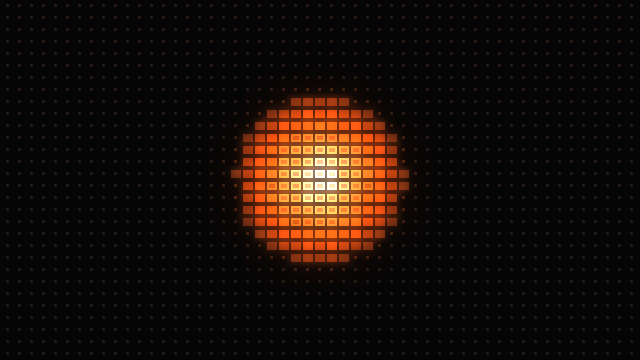 | `"Terracotta on black"` |
| 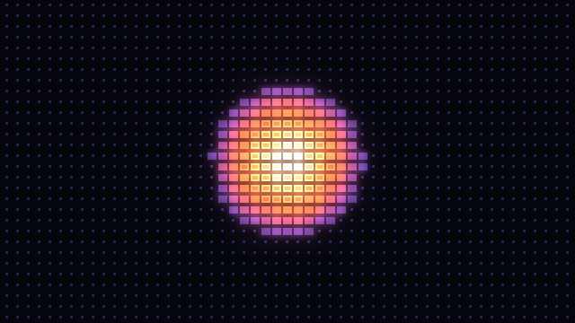 | `"Violet dusk"` |
| 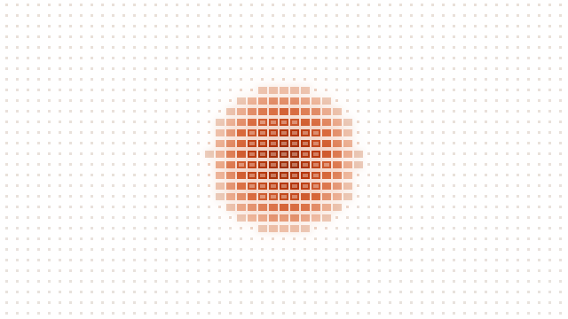 | `"Light"` |
| 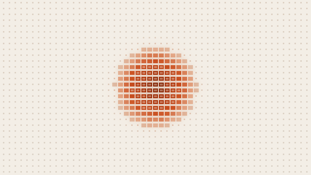 | `"Ink on paper"` |

### Light shapes

The values of `light`, in the `svgMode` the editor picks for each (`LIGHT_SHAPES[name].mode`).
`"custom"` uses `svgLight`, and `"none"` leaves only the text.

| Preview | `light` | `svgMode` |
|---|---|---|
| 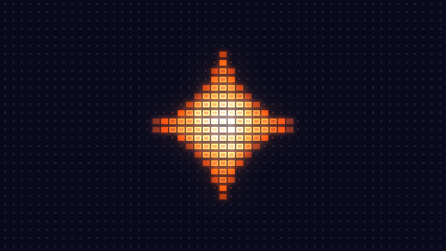 | `"sparkle"` | `"silhouette"` |
| 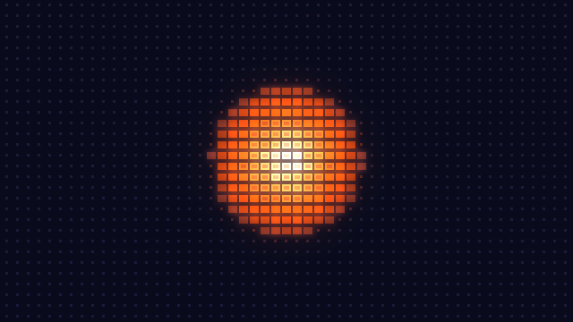 | `"sphere"` | `"tones"` |
| 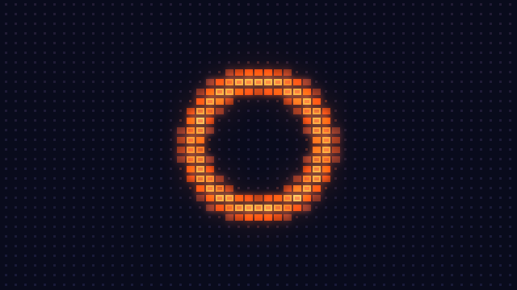 | `"ring"` | `"tones"` |
| 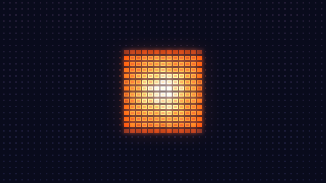 | `"square"` | `"silhouette"` |
| 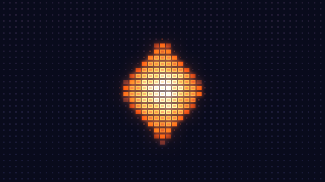 | `"diamond"` | `"silhouette"` |
| 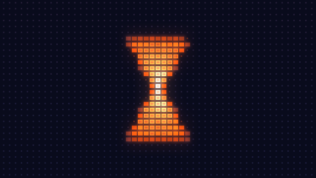 | `"hourglass"` | `"silhouette"` |

### Cell shapes

The values of `cellShape`, shown on a coarser grid (`stepX` and `stepY` at 20) so one cell can be
seen. `"custom"` uses `svgCell`.

| Preview | `cellShape` |
|---|---|
| 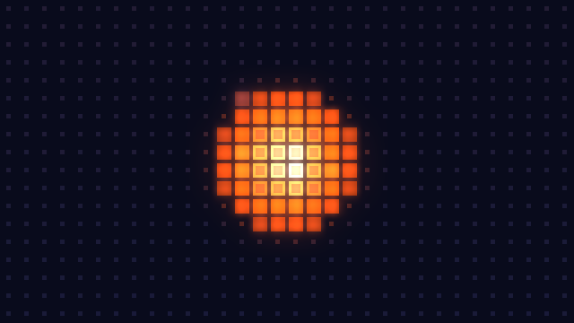 | `"square"` |
| 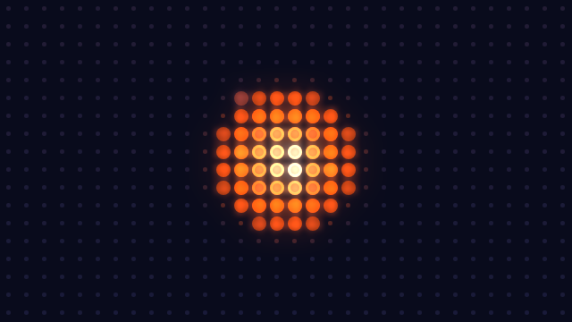 | `"circle"` |
| 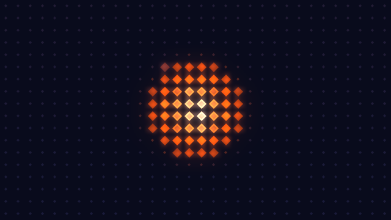 | `"diamond"` |
| 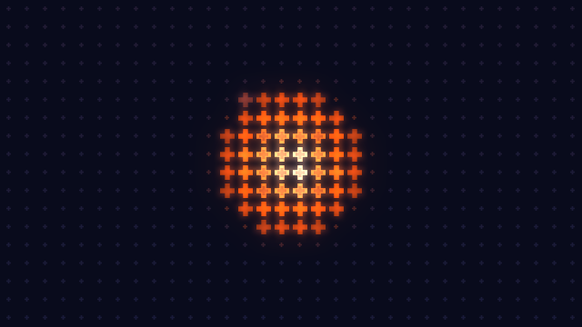 | `"cross"` |
| 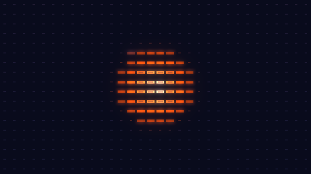 | `"line"` |

## Magnets and the anchor

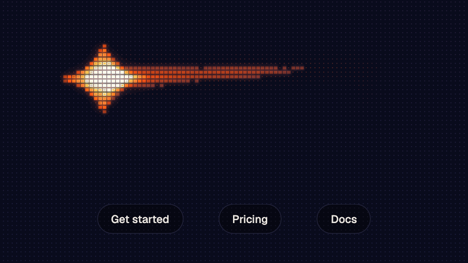

```js
const lg = createLitgrid(canvas, {
  pointer: window,
  magnets: "a[href], button",   // a selector or a list of elements; off by default
  anchor: "#cta",               // where the light is born
  magnetMode: "wrap",           // "wrap" (a rounded bar around the element) or "pull" (the centre only)
  magnetReach: 40,              // px from the element's edge
  magnetBorder: 56,             // px added around the element in wrap mode
  magnetTime: 0.35,             // seconds for the spring
});
lg.on("magnet", (el) => el?.animate([{ scale: 1 }, { scale: 1.04 }], 200));
```

The six options can also go inside `settings`, change through `update()`, and are part of
the editor's "Copy settings".

- The nearest magnet whose edge is within `magnetReach` px of the pointer catches the light.
  It stays caught until the pointer is more than `magnetReach × 1.25 + 6` px away, or a
  nearer magnet within reach wins, so the light does not flicker on the boundary. Elements
  inside `[inert]` or `[hidden]`, or with no size, are ignored, and a magnet that is
  removed, hidden or scrolled off screen lets go.
- The light travels on a critically damped spring (`ω = 6 / magnetTime`, integrated in
  short sub-steps), so it sets off gently and arrives without overshooting.
- In wrap mode the light's radius becomes half of the element's shorter side plus the
  border, and the stretch takes the rest of each side, so it frames the element. A non-round
  light shape is drawn as the round one while it wraps (`svgMagnet` can replace that round
  shape), and on release the stretch is zeroed in the same frame and the configured shape
  comes back, so a sparkle never shows as a cross. Pull mode only moves the centre.
- The `:focus-visible` element inside a magnet holds the light, so the keyboard drives it
  too. A real mouse move takes control back; scrolling under a still mouse does not.
- Until the pointer first moves, the anchor holds the light like a magnet while it is on
  screen; off screen, the light waits at its position.
- Element positions go through the canvas' rectangle on screen, so the light lands on the
  element on a canvas larger than the viewport, offset by scrolling or drawn at another
  resolution. Pass `pointer: window` when the magnets are outside the canvas.
- `lg.on("magnet", fn)` calls `fn` with the element (or `null`) whenever the element
  holding the light changes, the anchor included, and returns a function that stops
  listening. The library never styles or transforms your elements.

The states are drawn in [docs/flows/light-states.md](docs/flows/light-states.md).

## Clicks: burst and press

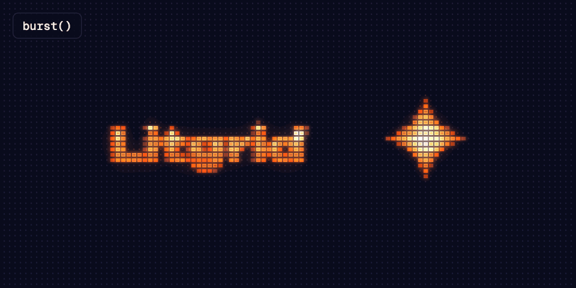

The library listens to the pointer for the light, not for clicks: the page says when one
happens. `burst()` is a quick click, and `press(true)` and `press(false)` are a button held
down and let go.

```js
canvas.addEventListener("click", () => lg.burst());
// or, to hold the swell while the button is down:
addEventListener("pointerdown", () => lg.press(true));
addEventListener("pointerup", () => lg.press(false));
```

- `burstSize` is how much the light grows at the peak (`0.6` is 60% larger), and
  `burstGlow` how much brighter it gets.
- `burstSecs` is the length of one burst: it swells in the first quarter and settles in the
  other three. A press swells in the same first quarter, stays big while held, and settles
  in the same three quarters from wherever it was when released.
- A light that a magnet wraps swells and brightens too. With reduced motion, neither call
  does anything.

## Reading and driving the light

`lg.light.get()` returns `{ state, x, y, element, size, stretchX, stretchY }`: where the light is, in client (viewport)
pixels, mapped through the canvas' rectangle on screen, so a canvas larger than the
viewport or offset by scrolling reports where the light really is; `size`, `stretchX` and
`stretchY` are what it is drawn with now, in the units of the settings. `state` is one of:

- `"waiting"`: following is on and the pointer has not been on the page yet.
- `"anchored"`: the anchor holds it, before the pointer first moves.
- `"following"`: it follows the pointer.
- `"held"`: a magnet holds it; `element` says which.
- `"resting"`: the pointer left the window and the light stays where it left (or following
  is off and the light sits at `shapeX`/`shapeY`, with its drift).
- `"manual"`: the page drives it.
- `"still"`: reduced motion, or animation off.

When the canvas moves on screen, as one that scrolls with the page does, or one taller than
the viewport that the page moves while scrolling, the light stays tied to what it follows. A
following light, or one resting where the pointer left, stays put on screen, so it remains
under a still pointer, trail included; a light held by a magnet or the anchor moves with that
element; and a light that drifts, waits, glides back or is driven by `light.set()` moves with
the canvas. Nothing has to be called for this: move the canvas, and the light keeps up.

`lg.light.set({ x, y, stretchX, stretchY, size })` takes control: `x` and `y` in client
pixels, `stretchX`, `stretchY` and `size` in the units of the `stretchX`, `stretchY` and
`shapeSize` settings, and any of them can be left out. The light stops following, magnets
stop catching it, and it goes where it is told until `lg.light.release()`, which hands
control back from where the light is, with no jump. `lg.pointer` is a read-only `{ x, y, on }`: where the instance thinks the
pointer is, in client pixels, and whether it is on the page.

## Porting from `Litgrid.mount`

The three plain scripts (`config.js`, `render.js`, `embed.js`) are now one package. Load
the IIFE build instead of the three files and call `Litgrid.createLitgrid(canvas, options)`
instead of `Litgrid.mount(canvas, options)`: the options are the same. `stop()` is now
`destroy()`. Several canvases on one page work, and reading the renderer's globals (`S`,
`mouse`, `W`, `H`) is replaced by `light.get()`, `light.set()`, `pointer`, magnets and the
anchor. With `followMouse` on, the light no longer drifts while the pointer is away: it
waits at its place before the pointer comes, and rests where the pointer left.

## The editor

- **Scene:** output format (16:9, 9:16 or 1:1), text, ambient light.
- **Shape:** the light shape is always an SVG. There are built-in ones (Sparkle,
  Sphere, Ring, Square, Diamond, Hourglass) and any SVG of your own, pasted or
  loaded from a file. It can follow the mouse, leave a fading trail and stretch
  with the speed of movement.
- **Cell:** each cell is drawn from an SVG too (square, circle, diamond, cross,
  line or your own), plus the grid size, the gaps and the thresholds between dim,
  solid and hollow.
- **Color:** dark and light presets, or a hand-picked palette. It can also take
  the colors from the input media.
- **Glow and Motion:** bloom, scanlines, pulse, drift and flicker.
- **Magnets:** the selector for magnets and the anchor, the mode, reach, border and
  travel time, with demo buttons on the stage to try them on. Under the stage, a read-out
  shows `light.get()`: the state, the position and the element holding the light.

An image, a video or the webcam can replace the scene as input. "Copy settings"
copies every setting as JSON.

**Export** saves the stage as a PNG of the current frame, a video (MP4 where the
browser can record it, WebM otherwise) or a looping GIF. Video and GIF are
recorded in real time, for the length you pick; the GIF is scaled down to the
width you pick.

Settings are kept in the browser. "Reset" goes back to the defaults.

### For AI agents (WebMCP)

The page registers [WebMCP](https://github.com/webmachinelearning/webmcp) tools,
so an AI agent running in the browser can set it up for you:

- `get_settings`: every current setting, the color presets and the output size.
- `set_settings`: change any setting from the panel; returns what was applied
  and what was ignored, and why.
- `apply_color_preset`: one of the named palettes.
- `set_custom_svg`: your own SVG as the light shape or the cell shape.
- `export_media`: save a PNG, a video or a GIF; it can also hand a PNG or GIF
  back to the agent, so it can look at the result.
- `reset_settings`: back to the defaults.

In browsers without WebMCP nothing changes. To try it in Chrome, turn on
`chrome://flags/#enable-webmcp-testing`.

## Development

```sh
npm install
npm run dev             # the editor, with the library from source
npm run build           # the package: dist/litgrid.js (ESM), dist/litgrid.iife.js and the types
npm run build:app       # the editor, into dist-app/
npm run build:examples  # the README's examples
npm run typecheck
npm run check:readme    # the README's examples match the files
npm run docs:media      # the README's images, into docs/media/
npm test                # Playwright: fixtures, examples and the editor (build all first)
```

- `src/` is the library: `index.ts` (the public entry), `engine.ts` (the canvas pipeline,
  the frame loop, the pointer, magnets and the light, all inside one instance),
  `config.ts` (presets, formats, built-in shapes and defaults) and `types.ts`.
- `app/` is the editor, a Vite app that imports the library from source.
- `examples/`, `fixtures/` and `tests/` are the README's examples, the pages the tests drive,
  and the Playwright suite.
- `docs/flows/light-states.md` draws the light's states, and `docs/media/` holds the README's
  images. `npm run docs:media` builds the package and renders every one of them again in headless
  Chromium, from the exported presets and shapes, with the time stepped by hand and a seeded
  random, so the same code gives the same files. The GIFs go through the editor's encoder in
  its delta mode, which writes only what changed from one frame to the next. A test fails when a
  preset or a shape has no image or no README row, or when a GIF is over its budget.

`.github/workflows/ci.yml` checks every push and pull request; `pages.yml` publishes the
editor to GitHub Pages from `main`; `release.yml` publishes the package to npm from a
`v*` tag (see [CHANGELOG.md](CHANGELOG.md)).

## License

[MIT](LICENSE)
