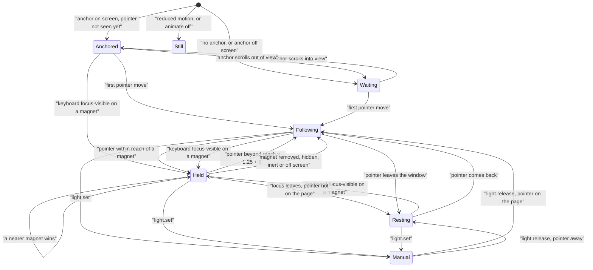

# Light states

What drives the light of one litgrid instance, as `light.get().state` reports it. The
proposal was drawn before the build; this is what the code does.

- **Waiting** has two places: with an anchor that is off screen, the light waits at the
  anchor's position; with no anchor, at `shapeX`/`shapeY`, without drifting.
- **Anchored** and **Held** wrap the light round the element (`magnetMode: "wrap"`) or only
  pull its centre (`"pull"`). Letting go zeroes the stretch in the same frame and restores
  the configured shape.
- **Held** lets go when the pointer is further than `magnetReach × 1.25 + 6` px from the
  element's edge, when a nearer magnet within reach wins, or when the element is removed,
  hidden, made inert, or scrolled off screen.
- Keyboard focus holds the light until the pointer really moves (a scroll under a still
  mouse does not count).
- **Still** is decided at start (reduced motion) or by `animate: false`; with reduced
  motion nothing moves the light, `light.set` included.
- With `followMouse` off, the light sits at `shapeX`/`shapeY` with its drift and reports
  **Resting**; magnets and the anchor still catch it.

